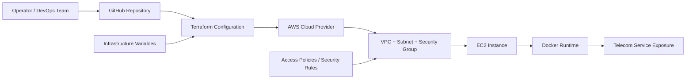
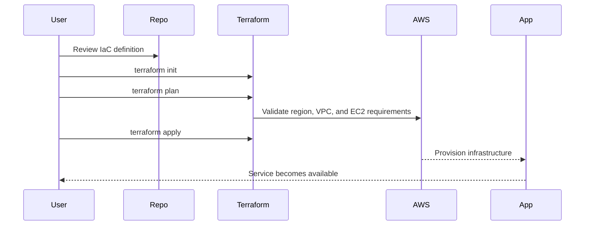

# Telecom Infrastructure Provisioning Platform

A polished, portfolio-ready Infrastructure as Code (IaC) project for telecom infrastructure automation. This repository demonstrates how cloud resources can be provisioned in a repeatable, scalable, and secure manner using Terraform, AWS, and containerized deployment patterns.

## Overview

This project is designed to address a common challenge in telecom operations: provisioning infrastructure consistently, quickly, and with reduced operational risk. Instead of manually creating and configuring environments, this solution models infrastructure as code so it can be reproduced across environments with predictable outcomes.

The repository combines:
- a presentation-style landing page for the solution
- a Docker-based deployment for local hosting
- a Terraform-based AWS provisioning workflow
- clear documentation for setup, deployment, and operations

## Why this project matters

Telecom environments often need to support:
- rapid environment setup
- consistent node configuration
- secure and repeatable provisioning
- faster rollback and redeployment
- reduced configuration drift

This project highlights how Infrastructure as Code can reduce operational complexity and improve the reliability of telecom infrastructure workflows.

## Architecture



## Operational Flow



## Project Goals

- Automate telecom infrastructure provisioning with code
- Reduce manual errors and deployment drift
- Improve repeatability, traceability, and availability
- Enable fast, controlled infrastructure deployment
- Create a scalable base for future cloud automation work

## Features

- Terraform-based AWS provisioning
- EC2 instance deployment with VPC, subnet, and IGW resources
- Security group configuration for SSH, HTTP, and HTTPS access
- Dockerized static landing page for local demo deployment
- Professional documentation and portfolio-ready presentation
- Extensible structure for future Kubernetes, Ansible, and CI/CD work

## Repository Structure

```text
.
├── README.md
├── index.html
├── main.tf
├── Dockerfile
├── .gitignore
├── IaC Provisioning Telecomm Report1.pdf
├── Telecomm_HLD_DOCX.pdf
├── .github/
│   └── workflows/
└── LICENSE (optional, add if needed for publication)
```

## Prerequisites

Before running the project, ensure the following are available:

- Docker
- Terraform v1.5 or newer
- AWS CLI configured with valid AWS credentials
- An AWS account with permission to create EC2 and networking resources

## Run Locally with Docker

Build the container:

```bash
docker build -t telecom-iac-demo .
```

Run the container:

```bash
docker run --name telecom-iac-demo -p 8080:80 telecom-iac-demo
```

Open the application in a browser:

```text
http://localhost:8080
```

## Provision Infrastructure with Terraform

Initialize Terraform:

```bash
terraform init
```

Validate the configuration:

```bash
terraform validate
```

Preview the deployment plan:

```bash
terraform plan
```

Apply the infrastructure:

```bash
terraform apply
```

Destroy the environment when it is no longer needed:

```bash
terraform destroy
```

## AWS Configuration Notes

Configure AWS credentials before deploying:

```bash
aws configure
```

Default configuration values in this repository:
- region: ap-south-1
- instance type: t3.micro
- VPC CIDR: 10.0.0.0/16
- subnet CIDR: 10.0.1.0/24

You can customize the Terraform variables defined in `main.tf` to fit your environment requirements.

### Restrict SSH Access

SSH access is restricted by default to `127.0.0.1/32`, which prevents remote SSH access until you explicitly set a trusted source. To allow access from your own IP address, pass your public IPv4 address as a `/32` CIDR:

```bash
terraform apply -var="allowed_ssh_cidr=YOUR_PUBLIC_IP/32"
```

Example:

```bash
terraform apply -var="allowed_ssh_cidr=203.0.113.10/32"
```

Avoid using `0.0.0.0/0` for SSH in production environments. HTTP and HTTPS remain publicly reachable by default for the demo web application.

## How the Project Works

1. The repository stores infrastructure definitions as code.
2. Terraform reads the configuration and prepares the required AWS resources.
3. A VPC, subnet, internet gateway, route table, and EC2 instance are created.
4. The EC2 instance is configured to host the application workload or demo interface.
5. The deployment remains version-controlled, repeatable, and easy to audit.

## Security and Reliability Considerations

This project is intentionally kept simple for demonstration and learning, but production environments should include:

- least-privilege IAM policies
- secure secret management
- restricted CIDR rules for administrative access
- remote state storage for Terraform
- monitoring, logging, and backup strategies

## Suggested Next Enhancements

- add Ansible playbooks for configuration automation
- integrate GitHub Actions for CI/CD
- add a Terraform remote state backend
- connect the project to a real telecom workload
- expand the solution with Kubernetes or container orchestration

## Project Status

This repository is a polished demo and prototype intended to showcase telecom infrastructure automation and cloud provisioning concepts in a professional portfolio format.

## Ownership

This project is developed and maintained by Mohd Dilshad Khan as a telecom infrastructure automation initiative.

## License

This project currently does not include a formal license file. If you plan to publish or reuse it commercially, add an appropriate open-source license before distribution.

---

Built for telecom infrastructure automation, cloud provisioning, and modern DevOps-driven deployment workflows.

"Infrastructure should be version-controlled, repeatable, and reliable."
