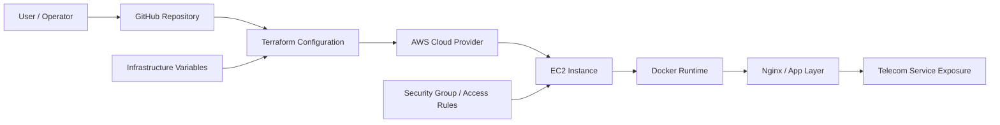
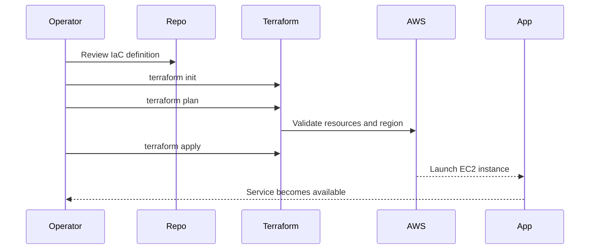

# Telecom Infrastructure Provisioning Platform

A professional portfolio-style project for telecom infrastructure automation using Infrastructure as Code (IaC). This repository demonstrates how infrastructure can be provisioned, standardized, and operated faster and more reliably in telecom environments using Terraform and containerized deployment patterns.

## Overview

This project was created to address a common challenge in telecom operations: provisioning infrastructure repeatedly, consistently, and with minimal manual effort. Instead of setting up servers manually, the solution models the infrastructure as code so it can be reproduced across environments with predictable outcomes.

The repository includes:
- a presentation landing page for the solution
- a working Docker-based static deployment
- a Terraform configuration prototype for AWS provisioning
- a professional project README for operational guidance and documentation

## Why this project matters

Telecom environments often require:
- rapid environment setup
- consistent node configuration
- secure and repeatable provisioning
- faster rollback and redeployment
- reduced configuration drift

This project demonstrates how IaC can reduce operational complexity and improve reliability in telecom infrastructure workflows.

## Architecture



## Operational flow



## Project goals

- Automate infrastructure provisioning with code
- Reduce manual configuration errors
- Improve repeatability and predictability
- Enable faster deployment of telecom environments
- Create a scalable, reusable foundation for cloud infra automation

## Features

- Infrastructure as Code using Terraform
- AWS EC2 provisioning template
- Dockerized static landing page deployment
- GitHub-ready documentation and project branding
- Reusable structure for future expansion to Kubernetes, Ansible, and CI/CD

## Repository structure

```text
.
├── README.md
├── index.html
├── main.tf
├── Dockerfile
├── .gitignore
├── pdfs/
│   └── (project documentation assets if added later)
└── .github/
    └── workflow files (if used in future)
```

## Prerequisites

Before using the project, ensure the following are installed:

- Docker
- Terraform v1.5 or newer
- AWS CLI configured with valid credentials
- An AWS account with permission to create EC2 instances

## Run locally with Docker

Build the container:

```bash
docker build -t telecom-iac-demo .
```

Run the container:

```bash
docker run --name telecom-iac-demo -p 8080:80 telecom-iac-demo
```

Open the app in a browser:

```text
http://localhost:8080
```

## Provision infrastructure with Terraform

Initialize Terraform:

```bash
terraform init
```

Validate the configuration:

```bash
terraform validate
```

Preview the deployment plan:

```bash
terraform plan
```

Apply the infrastructure:

```bash
terraform apply
```

Destroy when no longer needed:

```bash
terraform destroy
```

## AWS configuration notes

Set up AWS credentials before applying Terraform:

```bash
aws configure
```

The default configuration in this repo uses:
- region: ap-south-1
- instance type: t3.micro
- EC2 provisioning demo basics

You can customize the Terraform variables in `main.tf` to match your environment.

## How the project works

1. The repository stores infrastructure configuration as code.
2. Terraform reads the configuration and prepares cloud resources.
3. An EC2 instance is launched in the target AWS region.
4. The system can host or serve containerized applications.
5. The project remains version-controlled and repeatable across environments.

## Security and reliability considerations

This project is intentionally kept simple for learning and demonstration, but the following should be considered for production use:

- use IAM roles with least-privilege access
- store secrets in environment variables or secret stores
- restrict inbound security group rules
- use remote state storage for real deployments
- add monitoring, logging, and backup strategies

## Suggested next enhancements

- add Ansible playbooks for configuration management
- integrate GitHub Actions for CI/CD
- add Terraform remote state backend
- connect to a real telecom application workload
- deploy via Kubernetes for higher scalability

## Project status

This repository is a polished demo/prototype project intended to showcase telecom IaC automation and infrastructure provisioning concepts in a professional portfolio format.

## Team / ownership

This project is developed and owned by Mohd Dilshad Khan and the project team as a telecom infrastructure automation initiative.

## License

This project is currently provided as an educational and portfolio project without a formal license file. If you plan to publish or reuse it commercially, add an appropriate open-source license.

---

Built for telecom infrastructure automation, cloud provisioning, and modern DevOps-driven deployment workflows.

"Infrastructure should be version-controlled, repeatable, and reliable."
