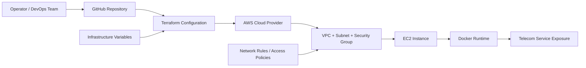
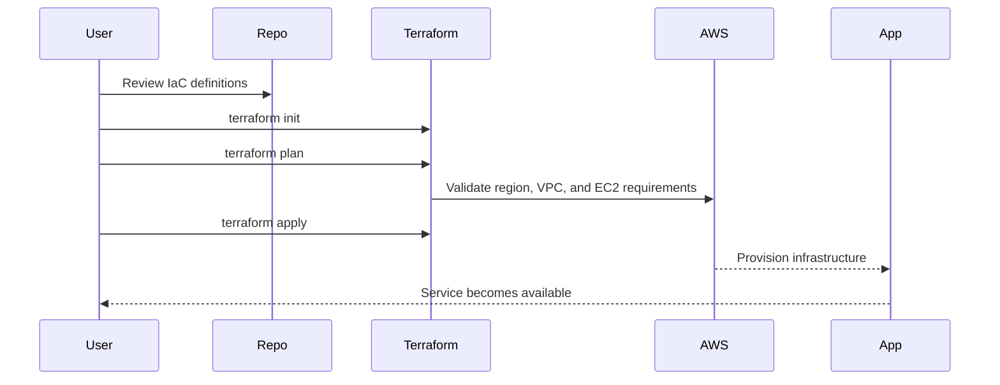

# Telecom Infrastructure Provisioning Platform

A modern Infrastructure as Code (IaC) project designed to showcase how telecom infrastructure can be provisioned, standardized, and deployed in a repeatable and scalable way using Terraform and AWS.

This repository combines a professional landing page, a deployable Docker container, and an AWS provisioning template to demonstrate a practical telecom automation workflow.

## Why this project matters

Telecom environments often require:
- rapid environment setup
- consistent node configuration
- secure and repeatable provisioning
- lower operational risk
- faster rollout and rollback

This project demonstrates how infrastructure can be treated as code rather than manual setup, reducing configuration drift and improving deployment confidence across environments.

## Solution overview

This project provides a simple but effective reference architecture for provisioning telecom-related infrastructure in the cloud with:
- Terraform for infrastructure definition
- AWS for cloud resource provisioning
- Docker for local hosting and demo deployment
- GitHub for version-controlled delivery and automation

## Architecture



## Operational flow



## Project goals

- Automate telecom infrastructure provisioning with code
- Reduce manual configuration errors
- Improve repeatability and predictability
- Support faster deployment and recovery
- Create a reusable foundation for future cloud automation projects

## Features

- Terraform-based AWS provisioning
- EC2 instance deployment with VPC, subnet, and IGW
- Security group configuration for SSH, HTTP, and HTTPS
- Dockerized static landing page deployment
- Professional documentation and portfolio-ready presentation
- Extensible structure for future Ansible, Kubernetes, and CI/CD integration

## Repository structure

```text
.
├── README.md
├── index.html
├── main.tf
├── Dockerfile
├── .gitignore
├── IaC Provisioning Telecomm Report1.pdf
├── Telecomm_HLD_DOCX.pdf
└── .github/
```

## Prerequisites

Before running the project, ensure you have:

- Docker
- Terraform v1.5 or newer
- AWS CLI configured with valid credentials
- An AWS account with permission to create EC2 resources

## Run locally with Docker

Build the container:

```bash
docker build -t telecom-iac-demo .
```

Run the container:

```bash
docker run --name telecom-iac-demo -p 8080:80 telecom-iac-demo
```

Open the app in your browser:

```text
http://localhost:8080
```

## Provision infrastructure with Terraform

Initialize Terraform:

```bash
terraform init
```

Validate the configuration:

```bash
terraform validate
```

Preview the deployment plan:

```bash
terraform plan
```

Apply the infrastructure:

```bash
terraform apply
```

Destroy the infrastructure when no longer needed:

```bash
terraform destroy
```

## AWS configuration notes

Configure AWS credentials before deployment:

```bash
aws configure
```

Default values in this repository are:
- region: ap-south-1
- instance type: t3.micro
- VPC CIDR: 10.0.0.0/16
- subnet: 10.0.1.0/24

You can customize these variables in `main.tf` to match your environment requirements.

## How the project works

1. The repository stores the infrastructure configuration as code.
2. Terraform reads the definitions and prepares the required AWS resources.
3. A VPC, subnet, internet gateway, route table, and EC2 instance are created.
4. The instance is configured to serve traffic and can support additional workloads.
5. The deployment remains version-controlled, repeatable, and easy to audit.

## Security and reliability considerations

This project is intentionally kept simple for demonstration and learning, but production environments should include:

- least-privilege IAM policies
- secure secret management
- restricted CIDR access for SSH and admin ports
- remote state storage for Terraform
- monitoring, logging, and backup strategies

## Suggested next enhancements

- add Ansible playbooks for configuration automation
- integrate GitHub Actions for CI/CD
- add Terraform remote state backend
- connect this prototype to a real telecom workload
- deploy the stack with Kubernetes or a container orchestration platform

## Project status

This repository is a polished demo/prototype project intended to showcase telecom infrastructure automation and cloud provisioning concepts in a professional portfolio format.

## Ownership

This project is developed and maintained by Mohd Dilshad Khan as a telecom infrastructure automation initiative.

## License

This repository currently does not include a formal license file. If you plan to publish or reuse it commercially, add an appropriate open-source license before distribution.

---

Built for telecom infrastructure automation, cloud provisioning, and modern DevOps-driven deployment workflows.

"Infrastructure should be version-controlled, repeatable, and reliable."
